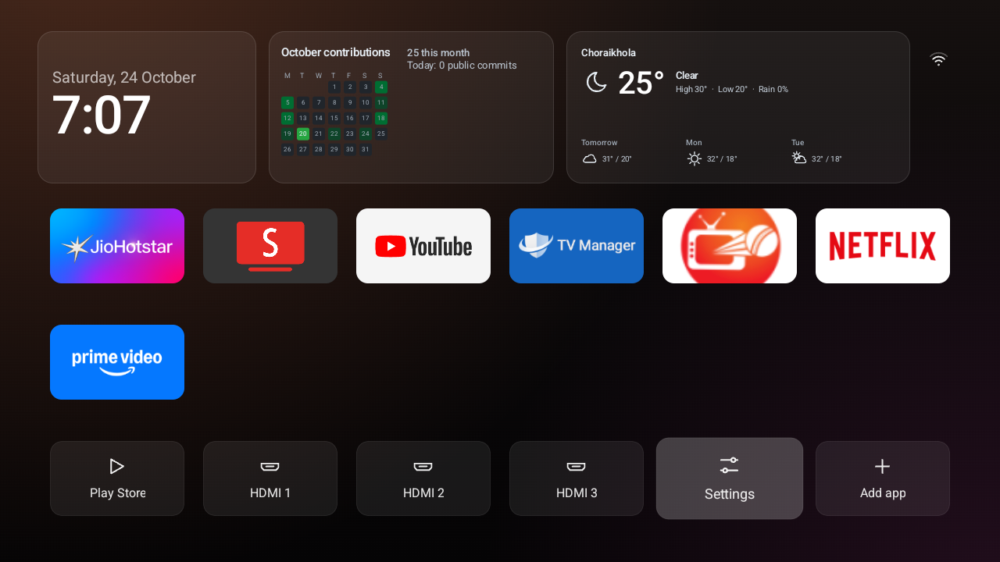

<div align="center">

# TV Cleaner

### A calm, fast home screen for Android TV: your apps, a clock, the weather and your GitHub activity. Nothing else.



</div>

<table>
<tr>
<td width="33%" valign="top"><b>🧹 No junk</b><br>No ads, no sponsored rows, no recommendations. Just the apps you choose.</td>
<td width="33%" valign="top"><b>⚡ Light and fast</b><br>One screen of plain Java. No libraries, no account, about 30 MB of RAM.</td>
<td width="33%" valign="top"><b>↩️ Fully reversible</b><br>Apps are turned off, never deleted. One command puts the old home screen back.</td>
</tr>
</table>

## What you get

- **Your apps, your way.** A tidy grid of the apps you pick. Rows of six, and the page scrolls once there are more.
- **HDMI inputs, Settings and an Add app tile** along the bottom.
- **A big clock and date** in the TV's own language (16 languages built in).
- **A network icon** showing Wi-Fi strength, Ethernet or offline. Optional Bluetooth, Sound and Picture shortcuts can sit beside it.
- **Optional weather** for one place: now, today's high and low, chance of rain, sunrise and sunset, and the next three days.
- **Optional GitHub activity:** the last three months of public contributions, with the date in every square, plus the commits you pushed today.
- **Rounded cards** keep the clock, GitHub and weather sections tidy. The layout adapts when your apps wrap onto a second row.
- **Edit on the TV.** Hold **OK** on an app (or press **Menu**) to move, replace, remove, uninstall it or open its app info.

The weather and GitHub sections are **off by default** and make no network requests until you turn them on (see [Optional sections](#optional-sections)).

## Requirements

- An Android TV or Google TV (Android 5 or newer), on the same network as your computer.
- [`adb`](https://developer.android.com/tools/releases/platform-tools) on your computer. On a Mac: `brew install android-platform-tools`.
- Developer options on the TV: **Settings → Device Preferences → About**, press **Build** 7 times. Then in **Developer options** turn on **USB debugging** (and **Network debugging** or **Wireless debugging** if you see it).

## Install

Build the home screen once (see [Build it yourself](#build-it-yourself)), then:

```sh
sh install.sh <TV_IP>
```

That installs it and makes it the default Home. Many TVs keep opening their own home screen, so the script offers to turn that off. Nothing is uninstalled, and `undo.sh` reverses it.

Choose your apps, add shortcuts, and switch on the optional sections in the same command. Arguments are, in order: apps, shortcuts, GitHub user, weather place.

```sh
sh install.sh <TV_IP> "com.netflix.ninja,com.google.android.youtube.tv"   # choose the apps
sh install.sh <TV_IP> "" "bluetooth,sound,picture"                         # add shortcuts
sh install.sh <TV_IP> "" "" <github-username>                              # GitHub activity
sh install.sh <TV_IP> "" "" "" "26.401,90.273,Kokrajhar"                   # weather
```

Not sure of an app's package name? Run `adb shell pm list packages | grep <part of its name>`. Put your defaults in `apps.txt` to bake them into the build.

## Optional sections

### Weather

```sh
sh install.sh <TV_IP> "" "" "" "<latitude>,<longitude>,<name to show>"
sh install.sh <TV_IP> "" "" "" none          # turn it off
```

Data comes from [Open-Meteo](https://open-meteo.com) (free, no account or key), at most every 30 minutes while Home is open. The last result stays on screen when you're offline. TVs have no GPS and their Wi-Fi location is unreliable, so you give it a fixed place. Find the coordinates by long-pressing the spot in Google Maps.

### GitHub activity

```sh
sh install.sh <TV_IP> "" "" <github-username>
sh install.sh <TV_IP> "" "" none             # turn it off
```

Shows the public contribution calendar for the last three months and the public commits pushed today. It reads `github.com` and `api.github.com` (public data only, no token) at most every 10 minutes while Home is open, and keeps the last result for offline use. Private contributions and private pushes aren't counted. The calendar comes from GitHub's public profile page, so if GitHub changes that page the section shows "unavailable" until the parser is updated.

### Privacy

The app declares the `INTERNET` permission so these two sections can work, but with neither turned on it never makes a request. Everything else on Home works without a network.

## Check, undo and recover

```sh
sh check.sh <TV_IP>                  # is the home screen still in charge?
sh check.sh <TV_IP> --fix            # put it back if an update changed it
sh check.sh <TV_IP> --fix my-tv.txt  # also check your own list of changes
sh undo.sh <TV_IP>                   # remove it and bring the TV's own home screen back
```

Your list has one change per line, for example:

```text
off com.example.app
global window_animation_scale 0
secure screensaver_enabled 0
device_config activity_manager max_cached_processes 4
```

If a TV ever gets stuck restarting, your computer can often still connect for a few seconds at each start. Use that to turn everything back on:

```sh
adb connect <TV_IP>
adb wait-for-device
for p in $(adb shell pm list packages -d | tr -d '\r' | sed 's/package://'); do adb shell pm enable "$p"; done
```

If the computer never connects, use the TV's recovery mode or a factory reset (how depends on the brand; see your TV maker's support page).

## Making the TV faster

A new home screen helps most when the TV isn't also running things you never use. Do this carefully, one app at a time:

```sh
adb shell pm list packages -3                 # apps you installed
adb shell pm list packages -s                 # apps that came with the TV
adb shell pm disable-user --user 0 <package>  # turn one off (it is not uninstalled)
adb shell pm enable <package>                 # turn it back on
adb shell cat /proc/meminfo | head -3         # free memory before and after
```

Never turn off: Google Play services (`com.google.android.gms`), Google Play, Settings, System UI, setup apps, the keyboard, Bluetooth, your HDMI inputs, the TV's input and tuner framework, or anything else the TV needs to start. If you're not sure, leave it on. After the last change, wait 30 seconds, then restart the TV once and check it starts normally. Turning off animations and the screensaver also helps and survives restarts:

```sh
adb shell settings put global window_animation_scale 0
adb shell settings put global transition_animation_scale 0
adb shell settings put global animator_duration_scale 0
adb shell settings put secure screensaver_enabled 0
```

## FAQ

<details>
<summary><b>Which TVs does it work on?</b></summary>
<br>

Android TV and Google TV running Android 5 or newer. It is tested on emulators (Android 9 and 11) and used on a real Android 14 TV. Many Sony, TCL, Hisense, Philips and Xiaomi TVs, Chromecast with Google TV and Nvidia Shield run Android TV. Some brands also sell non-Android models, so check **Settings → About** if you're not sure.

Not supported: Roku, Samsung (Tizen) and LG (webOS), which don't run Android. On Amazon Fire TV the cleanup commands work, but Amazon blocks changing the home screen on current models.

</details>

<details>
<summary><b>The TV still opens its own home screen</b></summary>
<br>

Run `sh install.sh <TV_IP>` again and answer **y** when it offers to turn off the TV's own launcher. If Android asks which home screen to use, pick **TV Cleaner** and choose **Always**. Run `sh check.sh <TV_IP> --fix` after a system update.

</details>

<details>
<summary><b>Home opens Google TV's setup screen instead (Sony BRAVIA and others)</b></summary>
<br>

On some Google TVs, once Google TV's home screen (`com.google.android.apps.tv.launcherx`) is off, Android picks the setup app (`com.google.android.tungsten.setupwraith`) for Home instead. `install.sh` spots this and asks before turning the setup app off too. It only asks if Home opens exactly that app, Google TV's home screen is already off and the TV has finished its first setup. `YES=1` doesn't turn it off; use `YES_SETUP=1` for that. `undo.sh` turns it back on. To undo it by hand:

```sh
adb shell pm enable com.google.android.tungsten.setupwraith
adb shell pm enable com.google.android.apps.tv.launcherx
```

If the TV ever asks to be set up again, or a setup screen won't finish, turn the setup app back on first.

</details>

<details>
<summary><b>The sleep timer goes back to "Never" after a restart</b></summary>
<br>

Some TV firmwares throw the timer away on boot, whether it's set over adb or in the TV's own Energy saver menu, and nothing on the TV side can keep it without root. Animations and the screensaver setting do stick. Run `sh check.sh <TV_IP>` after a restart to see what survived.

</details>

<details>
<summary><b>A button on the remote stopped working</b></summary>
<br>

Some remote buttons are handled by the TV's own home screen or by apps you turned off. Run `adb shell dumpsys window policy` to see which apps the remote's global keys go to, and turn that app back on if it isn't your TV's home screen. On some Google TVs the YouTube button goes to Google TV's own home screen, which `install.sh` turns off, so open YouTube from its tile instead.

</details>

<details>
<summary><b>The TV opens Live TV or HDMI when it turns on</b></summary>
<br>

That's a TV setting, not the home screen. Look for a "power on" or "startup" input option in the TV's own settings.

</details>

<details>
<summary><b>How do I change the apps later?</b></summary>
<br>

Use the remote: hold **OK** on an app (or press **Menu**) to move, replace, remove or uninstall it, or open its app info. **Add app** at the end of the bottom row adds one back. To reset to the list from your computer, run `sh install.sh <TV_IP> auto`.

</details>

<details>
<summary><b>Can I add my language?</b></summary>
<br>

Labels follow the TV's language. To add yours or fix a translation, edit `src/com/tvcleaner/home/Strings.java`. The weather and GitHub sections are English-only for now.

</details>

## Build it yourself

1. Install Java 17 and the Android SDK. On a Mac:
   ```sh
   brew install openjdk@17
   brew install --cask android-commandlinetools
   sdkmanager "platforms;android-34" "build-tools;34.0.0"
   ```
2. `sh build.sh` makes `out/tvcleaner.apk`. A signing key (`key.jks`) is created on the first build. **Keep it**: updates must be signed with the same key.
3. `sh install.sh <TV_IP>` installs your build.

Tests:

```sh
sh ci/unit-test.sh                          # quick checks on your computer
sh ci/smoke-test.sh <TV_IP or emulator>     # installs it and drives it on a real TV or an emulator
```

Pushing to GitHub runs the same tests (`.github/workflows/build.yml`), and tagging a version such as `v1.0.0` publishes a release APK. To sign releases with your own key, set the `RELEASE_KEYSTORE` (base64) and `RELEASE_KEYSTORE_PASS` secrets.

### Project layout

| Path | What it is |
|---|---|
| `src/com/tvcleaner/home/MainActivity.java` | The home screen: grid, focus, edit menu, network icon, layout |
| `.../GraphPanel.java`, `ContributionGraphView.java`, `GitHubContributions.java` | The optional GitHub section |
| `.../WeatherPanel.java`, `WeatherView.java`, `Weather.java` | The optional weather section |
| `.../Strings.java`, `LineIcon.java` | Translations and the line icons |
| `install.sh`, `undo.sh`, `check.sh` | Install, undo and verify, over adb |
| `ci/`, `test/` | Smoke test, unit tests |

## Disclaimer

Use this at your own risk. You're responsible for your own TV. Turning off system apps can stop a TV from starting, so change one thing at a time, keep a list, and know how to [undo it](#check-undo-and-recover).

## License

MIT, see [LICENSE](LICENSE).
